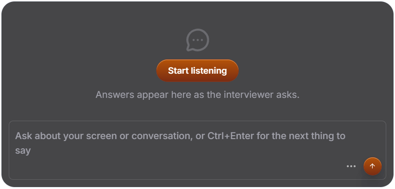

# Undertone

An open-source interview and meeting copilot for Windows (macOS overlay works; system-audio capture is Windows-only for now). A small capture-proof pill floats at the top of your screen; press Start and it listens to both sides of the call, transcribes locally, and whispers what to say next a second after the interviewer stops talking. Bring your own model: your Claude Code login, an Anthropic key, any OpenAI-compatible server, or Ollama on your own machine.

<p align="center">
  
</p>
<p align="center">
  
</p>

## What it does

- **Listens to both sides.** Your microphone and the system audio (the other party) are captured separately, so the transcript knows who said what.
- **Transcribes on your machine.** Silero voice detection plus Whisper through transformers.js (WebGPU when available, WASM otherwise). Nothing is uploaded to transcribe.
- **Answers on its own.** When the interviewer asks something and goes quiet, the answer starts streaming without you touching anything. If you start talking first, it starts right away. Turn it off with the Auto button.
- **Sounds like you.** Upload your resume or notes once; every answer draws on it. Answers are written as spoken, first-person sentences, two to four of them, with no bullet points or assistant tone.
- **Sees your screen when you want.** With Screen on, a screenshot (with the overlay hidden) goes along with each question, so it can answer about a slide or a coding problem.
- **Invisible to screen share.** One toggle sets the operating system's content-protection flag, so meeting apps and recorders capture everything except Undertone.
- **Your choice of model.** Claude Code CLI (no key, uses your Claude login, kept warm for one-to-two-second answers), Anthropic API, OpenAI-compatible servers (OpenRouter, Groq, LM Studio, vLLM) or Ollama. Switch from the Settings window; the key never leaves the main process.

## Install

Requirements: Node.js 22+. Windows 10 or 11 for system-audio capture.

```bash
git clone https://github.com/saintAdrian7/undertone.git
cd undertone
npm install
npm run dev
```

The first start downloads the Whisper model from Hugging Face (about 150 MB for `whisper-base`); it is cached afterwards. Everything else is bundled.

Pick a model in **Settings** (click the pill) or in a `.env` file copied from `.env.example`:

```
# Claude Code CLI, signed in on this machine (no key; haiku is fastest, sonnet answers best)
LLM_PROVIDER=claude-code
LLM_MODEL=sonnet

# Anthropic API
ANTHROPIC_API_KEY=sk-ant-...

# Any OpenAI-compatible server
LLM_PROVIDER=openai
LLM_BASE_URL=https://openrouter.ai/api/v1
LLM_API_KEY=...
LLM_MODEL=meta-llama/llama-3.3-70b-instruct:free

# Ollama on this machine
LLM_PROVIDER=ollama
LLM_MODEL=llama3.2
```

Settings chosen in the window override `.env`. Screenshots are sent as image parts, so pick a vision-capable model if you keep Screen on; text-only models still work for the transcript.

To package a Windows build into `dist/win-unpacked` (electron-builder flips the Electron fuses so the shipped binary cannot run as Node, cannot be attached with `--inspect`, and only loads code from its asar):

```bash
npm run dist
```

## Using it

| Action | How |
|---|---|
| Start or stop listening | The round button on the pill, the **Start listening** button in the panel, or `Ctrl+Shift+\` |
| Show or hide the panel | **Ask** / **Hide** on the pill, or the chevron that appears at the panel's top-left |
| Automatic answers | The lightning button on the pill (accent colour = on) |
| Ask something yourself | Type in the panel and press Enter, or `Ctrl+Enter` anywhere for "What should I say next?" |
| Screenshots, invisibility, resume, quit | The **⋯** menu next to the send button |
| Open Settings | Click the pill body, or the tray menu |
| Move the pill | Drag it, or `Ctrl+Arrow keys`. Double-click to reset. |
| Scroll the answer | `Ctrl+Shift+Up/Down` |
| Clear the answer | `Ctrl+R` or the **⋯** menu |
| Hide from screen share | `Ctrl+\`, the **⋯** menu, or Settings |

Settings has six sections: General (automatic answers, screenshots, invisibility, focus, accent colour, open at login), Model, Profile (resume preview), Audio (microphone), Shortcuts (click to record, double-click to reset) and About.

Global shortcuts are first come, first served across the desktop. If another app owns one, the log reports it and that action stays available from the pill.

## Privacy

Audio capture, voice detection and transcription never leave your machine. When an answer is generated, the recent transcript, your resume (if uploaded) and, with Screen on, a screenshot are sent to the model you configured and nowhere else. The resume text and model settings live in the app's user-data folder; the API key is stored there too and is never shown back to the interface. Nothing is fetched at runtime except the Whisper model on first use.

## Please use it fairly

Undertone is a tool for preparing, practising and staying composed. Many employers forbid live assistance in interviews; check the rules of whatever you are joining and be honest about what you use. The authors do not endorse deceiving an interviewer.

## How it works

```
mic (getUserMedia) ───┐
                      ├─ Silero VAD (per speaker) ─ utterance ─ Whisper (transformers.js, local)
system audio ─────────┘                                             │
(loopback via getDisplayMedia)                                      ▼
                                                        transcript in shared state
                                                                    │
auto trigger / Ctrl+Enter ─ screenshot (overlay hidden) ─ model provider (main process) ─ streamed answer
```

- `src/main` is the Electron main process: windows, global shortcuts, screenshot capture, the model providers, the answer service with the auto-answer scheduler, and the IPC handlers. Keys never leave this process.
- `src/renderer` is the React UI (pill, panel, settings) plus the audio pipeline.
- `src/shared` holds the state schema, the IPC contract, the provider interfaces and the brand constants.
- `docs/superpowers/specs` holds the UI design notes.

The UI follows the layout and interaction patterns of Cluely's overlay, rebuilt from scratch with our own styles, icons and assets.

## Configuration

| Variable | Default | Purpose |
|---|---|---|
| `LLM_PROVIDER` | | `claude-code`, `anthropic`, `openai` or `ollama` |
| `LLM_MODEL` | | Model name for that provider |
| `LLM_BASE_URL` | OpenAI or Ollama default | `/v1` base of an OpenAI-compatible server |
| `LLM_API_KEY` | | Key for that server (Ollama needs none) |
| `ANTHROPIC_API_KEY` | | Selects the Anthropic API when `LLM_PROVIDER` is unset |
| `ANTHROPIC_MODEL` | `claude-sonnet-5-5` | Anthropic model |
| `CLAUDE_CODE_COMMAND` | `claude` | Path to the Claude Code CLI if it is not on PATH |
| `VITE_WHISPER_MODEL` | `onnx-community/whisper-base` | Any Whisper model published for transformers.js |

## Development

```bash
npm test              # unit and component tests
npm run test:coverage
npm run typecheck
npm run lint
```

Main-process logic is written as pure modules with Electron injected at the edges, so overlay, shortcut, capture, auto-answer and provider behaviour is covered by fast tests without launching Electron. The project was built test-first; each feature landed as a failing-test commit followed by the implementation.

## Contributing

Issues and pull requests are welcome. Start with [CONTRIBUTING.md](CONTRIBUTING.md): it covers setup, the code layout, the test-first workflow and what a good PR looks like. Issues labelled `good first issue` are a gentle way in. Please read the [code of conduct](CODE_OF_CONDUCT.md), and report anything security-related through [SECURITY.md](SECURITY.md) rather than a public issue.

## Licence

MIT. Fonts: Inter (SIL Open Font License) via `@fontsource-variable/inter`. Icons: Lucide (ISC).
